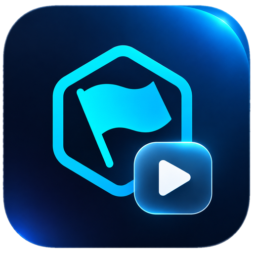

<div align="center">



# USP Stories

**Десктопное приложение, которое превращает идею в готовое видео: сценарий, кадры, видео, голос, музыка, субтитры и монтаж.**

Большая часть работы идёт на вашем компьютере — без ключей и без оплаты за генерацию. Облачные сервисы подключаются по желанию.

[Скачать для Windows](../../releases/latest) · [Возможности](#возможности) · [Что нужно](#что-нужно) · [Разработка](#разработка)

</div>

## Возможности

- **Сценарий из идеи.** Автор сценария (локальная модель через Ollama или Gemini, OpenRouter, Groq) разбивает идею на сцены с закадровым текстом под выбранную длину ролика.
- **Кадры и видео на своём компьютере** через ComfyUI: Z-Image Turbo, Qwen-Image 2.1, Krea-2, LTX 2.5, MiniMax H3 с лицами персонажей, FastH3, Wan 2.2.
- **Говорящая голова** (InfiniteTalk): человек с фото говорит голосом клипа, губы в такт.
- **Google Flow и Gemini в вашем Chrome**: видео с персонажами Flow через @-упоминания и музыка Gemini — по вашей подписке. Если Flow отклоняет сцену, её сделает локальная модель.
- **Персонажи**: карта персонажа из портрета или из видео с человеком, манера держаться и мимика, клон голоса.
- **Голос**: VoiceStudio (локально, клоны голоса), Gemini TTS, ElevenLabs. Быстрая переозвучка при неверном ударении.
- **Музыка**: ACE-Step, Stable Audio 3, MiniMax Music 3 локально или Gemini (Lyria) по ключу или в Chrome.
- **Монтаж**: таймлайн, 18 переходов, наложения и логотипы, анимированные субтитры (по словам, по буквам, свои шрифты и пресеты), заставки в начале и конце, экспорт MP4 до 4K.
- **Проекты-папки**: общие персонажи, базовый промпт стиля (по сайту или видео), субтитры, логотипы, музыка и заставки для всех видео папки.
- **Учёт расходов**: токены, деньги, кредиты и бонусы по видео, папке и всего.
- **Локальные модели в настройках**: что установлено, что рекомендуется, скачать недостающее с докачкой.

## Что нужно

- Windows 10/11, 64 бит.
- Для локальной генерации — [ComfyUI](https://www.comfy.org) и видеокарта NVIDIA (кадры — от 12 ГБ, видео — 24 ГБ). Модели скачиваются из приложения: «Настройки › Локальные модели».
- По желанию:
  - [Ollama](https://ollama.com) — сценарий на своём компьютере;
  - VoiceStudio — клоны голоса;
  - Chrome с [browser-harness](https://github.com/browser-use/browser-harness) — Google Flow и Gemini;
  - ключи Gemini, ElevenLabs или Higgsfield — облачные сервисы.

## Установка

Скачайте `USPStories-Setup-<версия>.exe` со страницы [Releases](../../releases/latest) и запустите. Установщик не подписан, поэтому Windows может показать предупреждение SmartScreen: «Подробнее › Выполнить в любом случае».

## Разработка

```bash
npm install
npm run dev        # приложение с горячей перезагрузкой
npm run typecheck  # проверка типов
npm run dist       # установщик Windows в папке dist/
```

Electron + React + TypeScript, сборка — electron-vite и electron-builder. Схемы ComfyUI для музыки и новых моделей лежат в `resources/workflows`, остальные — в папке схем из настроек.

## Автор и лицензия

[Aleksandr Uspeshnyy](https://uspeshnyy.ru). Лицензия MIT — см. [LICENSE](LICENSE).
