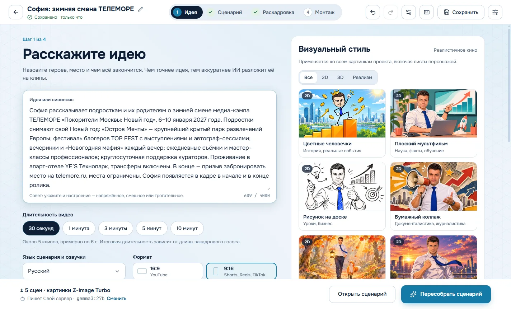
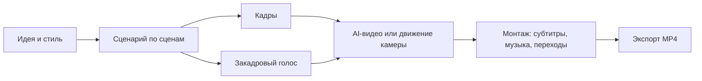
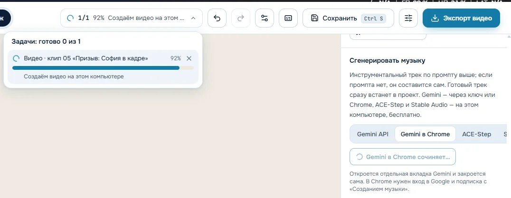
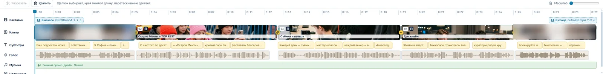
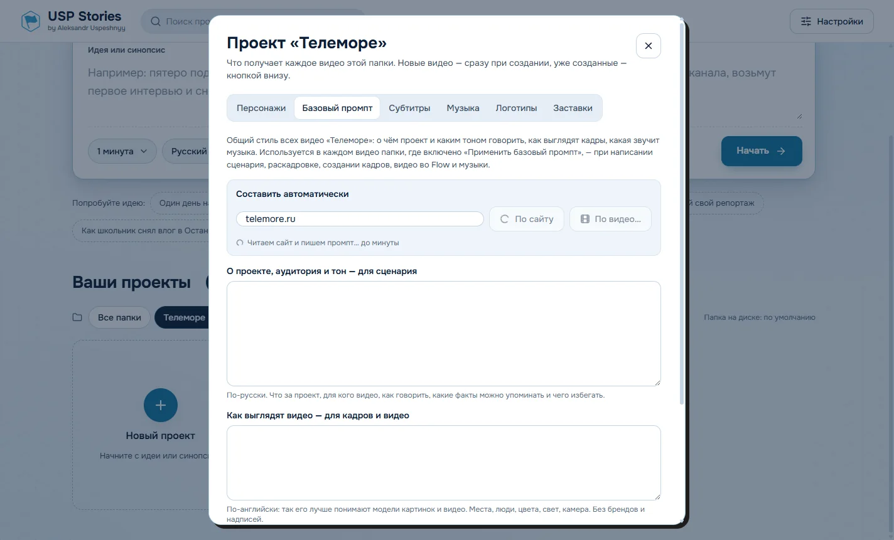
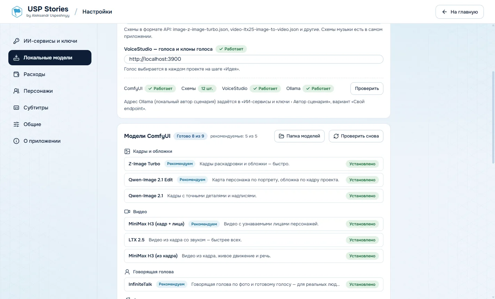
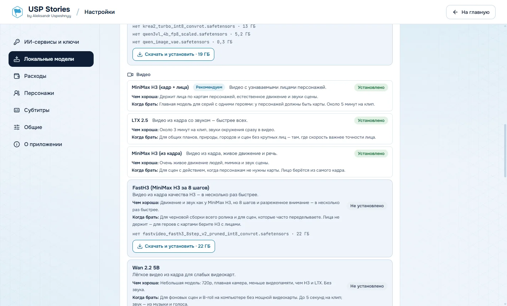
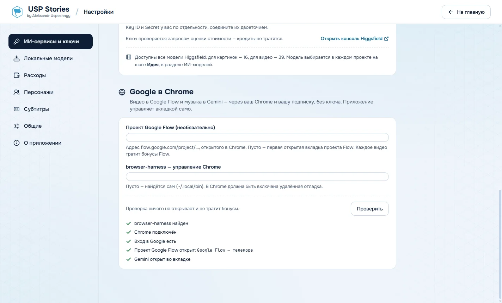

<div align="center">


# USP Stories

**Десктопное приложение, которое превращает идею в готовое видео: сценарий, кадры, видео, голос, музыка, субтитры и монтаж.**

Большая часть работы идёт на вашем компьютере — без ключей и без оплаты за генерацию. Облачные сервисы подключаются по желанию.

[**Скачать для Windows**](../../releases/latest) · [Возможности](#возможности) · [Установка](#установка) · [Первый ролик](#первый-ролик-за-10-минут) · [Модели](#модели) · [Разработка](#разработка)



</div>

## Что это

Короткий ролик для Reels, Shorts или YouTube обычно собирают из пяти-шести сервисов: сценарий в чат-боте, кадры в одной нейросети, видео в другой, голос в третьей, музыка отдельно, монтаж в редакторе. USP Stories делает всё это в одном окне и ведёт ролик по четырём шагам:



На каждом шаге результат можно поправить руками, перегенерировать одну сцену или вернуться назад.

## Возможности

### Идея и сценарий

- Пишете идею или синопсис, выбираете длину (от 30 секунд до 10 минут), формат 9:16 или 16:9, язык и визуальный стиль.
- Автор сценария разбивает идею на сцены с закадровым текстом и следит за длиной: на 30 секунд — около 55 слов.
- Сценарий пишет локальная модель через [Ollama](https://ollama.com) или облачная — Gemini, OpenRouter, Groq.

### Кадры

- Раскадровщик описывает каждую сцену как один кадр в выбранном стиле.
- Кадры рисуются локально в ComfyUI (Z-Image Turbo, Qwen-Image 2.1 и Turbo, Krea-2) или в Higgsfield.
- У каждого кадра можно выбрать, чем его рисовать: любая из этих моделей, **Google Flow в Chrome** (лица персонажей Flow через @-упоминания) или **ChatGPT в Chrome** (карты персонажей уходят вложениями). Картинка обрезается под формат проекта.
- Свой кадр можно загрузить с диска, промпт картинки — поправить.

### Видео

Для каждой сцены — выбор: бесплатное движение камеры по кадру или настоящее AI-видео. У каждого способа видно, что он делает, сколько стоит и сколько примерно длится.

| Способ | Где работает | Когда брать |
|---|---|---|
| MiniMax H3 с лицами | на этом компьютере | серии с одними героями: держит лица по картам персонажей |
| LTX 2.5 | на этом компьютере | общие планы и сцены без крупных лиц — быстрее всех |
| FastH3 | на этом компьютере | черновая сборка и частые переделки |
| Wan 2.2 5B | на этом компьютере | фоновые сцены на видеокарте поскромнее |
| Говорящая голова (InfiniteTalk) | на этом компьютере | человек с фото говорит голосом клипа, губы в такт |
| Google Flow (Omni) | ваш Chrome | персонажи Flow через @-упоминания, по вашей подписке |
| Модели Higgsfield | облако | по кредитам Higgsfield |

**Если Google Flow отклоняет сцену** («нельзя создавать видео, которые могут нанести ущерб репутации…»), приложение повторяет запрос без имён, брендов и дат, а при втором отказе делает сцену локально. Сцены, где реальный человек говорит в камеру, сразу идут в говорящую голову: Flow такие обычно не пропускает.

### Персонажи

- **Карта персонажа**: внешность, одежда, манера держаться и двигаться, мимика, голос, имя персонажа в Google Flow.
- Карту можно сделать из портрета или **из видео с человеком**: приложение посмотрит кадры, опишет внешность, жесты и мимику, соберёт карту и при желании клонирует голос.
- Библиотека персонажей общая для всех проектов.

### Голос

- VoiceStudio на этом компьютере (в том числе клоны голоса), Gemini TTS или ElevenLabs.
- Голос ошибся в ударении — кнопка «Ударение» переозвучивает только эту фразу; есть «Другой дубль».
- Тайминги слов для субтитров — Whisper на этом компьютере.

### Музыка



- Локально: ACE-Step 1.5 (быстро, по стилю), Stable Audio 3 (точная длина, звуки), MiniMax Music 3 (целые композиции до 5 минут).
- Gemini (Lyria) по ключу или в вашем Chrome.
- Промпт музыки составляется по сценарию; все треки проекта сохраняются, переключаться между ними — в один клик.

### Монтаж



- Таймлайн с клипами, субтитрами, голосом, музыкой и наложениями; отмена и возврат (Ctrl+Z / Ctrl+Shift+Z).
- 18 переходов, логотипы и картинки поверх видео.
- Субтитры: стили, анимация появления (карточкой, по словам, по буквам), свои шрифты, пресеты, размер и межстрочный интервал, превью.
- Заставки в начале и в конце (несколько вариантов 9:16 и 16:9) — видны на таймлайне.
- Экспорт MP4 до 4K, 30 или 60 fps, выравнивание громкости, приглушение музыки под голос, файл субтитров .srt. Экспорт идёт в фоне.

### Проекты-папки и базовый промпт



Видео складываются в папки — например, по бренду или кампании. У папки свои персонажи, субтитры, логотипы, музыка и заставки, и каждое новое видео получает их сразу.

**Базовый промпт** задаёт общий стиль серии: о чём проект, для кого, каким тоном говорить, как выглядят кадры и какая звучит музыка. Его можно составить по адресу сайта или по видео бренда, а потом поправить. В каждом видео есть флажок «Применить базовый промпт».

### Задачи и расходы

- Все генерации видны в шапке проекта: «2/4 · 92% Создаём видео». Любую можно отменить.
- Учёт расходов по видео, папке и в целом: токены, деньги (по ценам Gemini API и ответам OpenRouter), кредиты Higgsfield, бонусы Flow, треки Lyria, время видеокарты.

### Локальные модели



В «Настройки › Локальные модели» видно, что установлено, что рекомендуется для каждой задачи и чем каждая модель хороша. Недостающее скачивается одной кнопкой прямо в папки ComfyUI; прерванная загрузка продолжается с того же места. Там же модели Ollama и статус распознавания речи.



## Установка

### 1. Приложение

Скачайте `USPStories-Setup-<версия>.exe` со страницы [Releases](../../releases/latest) и запустите. Установщик пока не подписан, поэтому Windows может показать предупреждение SmartScreen: «Подробнее» → «Выполнить в любом случае».

Нужна Windows 10 или 11, 64 бит.

### 2. ComfyUI — кадры, видео и музыка на своём компьютере

1. Установите [ComfyUI](https://www.comfy.org) (portable-версия для Windows) и запустите его. По умолчанию он отвечает на `http://127.0.0.1:8188`.
2. В приложении откройте «Настройки › Локальные модели» и нажмите «Проверить» в блоке «Подключение».
3. Скачайте нужные модели кнопкой «Скачать и установить». Начните с рекомендуемых.

Видеокарта NVIDIA: кадрам хватит 12 ГБ видеопамяти, для видео лучше 24 ГБ. Модели весят от нескольких до 20+ ГБ каждая.

Схемы ComfyUI для музыки и новых моделей встроены в приложение. Остальные лежат в папке схем из настроек (по умолчанию `C:\AI\ComfyUI-workflows`).

### 3. По желанию

| Что | Зачем | Где настроить |
|---|---|---|
| [Ollama](https://ollama.com) | сценарий и разбор видео без интернета (gemma3:27b или 12b) | «ИИ-сервисы и ключи › Автор сценария», вариант «Свой endpoint» |
| VoiceStudio | голоса и клоны голоса на этом компьютере | «Локальные модели › Подключение» |
| Chrome + [browser-harness](https://github.com/browser-use/browser-harness) | Google Flow и Gemini по вашей подписке | «ИИ-сервисы и ключи › Google в Chrome», кнопка «Проверить» |
| Ключ Gemini | сценарий, озвучка, музыка Lyria | «ИИ-сервисы и ключи» |
| Ключ ElevenLabs | озвучка с точными таймингами слов | «ИИ-сервисы и ключи» |
| Ключ Higgsfield | облачные кадры и видео | «ИИ-сервисы и ключи» |



Для Google Flow и Gemini в Chrome должна быть включена удалённая отладка: откройте `chrome://inspect/#remote-debugging`, отметьте «Allow remote debugging» и нажмите «Разрешить» во всплывающем окне. Для Flow откройте в Chrome проект, где лежат ваши персонажи.

Ключи хранятся в зашифрованном виде на этом компьютере и отправляются только напрямую в нужный сервис.

## Первый ролик за 10 минут

1. **Главный экран → «Новый проект».** Напишите идею, выберите длину, язык, формат и стиль.
2. **«Начать».** Автор сценария разобьёт идею на сцены. Поправьте текст сцен, если нужно.
3. **Раскадровка.** Нажмите «Создать картинки», затем «Записать голос». Для сцен, которым нужно движение, выберите «AI-видео» и способ создания.
4. **Монтаж.** Проверьте ролик в плеере, выберите стиль субтитров, добавьте музыку («Музыка › Сгенерировать музыку»).
5. **«Экспорт видео».** Файл появится в `Видео\USP Stories` — для видео из папки проекта в подпапке с её названием.

## Модели

| Группа | Модель | Чем хороша |
|---|---|---|
| Кадры | **Z-Image Turbo** ★ | кадр за 10–20 секунд, хватает для раскадровки и обложек |
| Кадры | **Qwen-Image 2.1 Edit** ★ | карты персонажей из фото, обложки по кадрам |
| Кадры | Qwen-Image 2.1 / Turbo | точные детали и надписи, в том числе по-русски |
| Кадры | Krea-2 Turbo | эстетика: свет, цвет, живые лица — для обложек |
| Видео | **MiniMax H3 с лицами** ★ | держит лица персонажей по их картам |
| Видео | LTX 2.5 | самая быстрая, со звуками окружения |
| Видео | MiniMax H3 (из кадра), FastH3 | живое движение и звук; FastH3 — в несколько раз быстрее |
| Видео | Wan 2.2 5B | лёгкая модель, 720p, без звука |
| Говорящая голова | **InfiniteTalk** ★ | губы точно в такт голосу, лицо с фото не меняется |
| Музыка | **ACE-Step 1.5 XL Turbo** ★ | быстрая фоновая музыка по стилю |
| Музыка | Stable Audio 3 Medium | точная длина, музыка и звуки |
| Музыка | MiniMax Music 3 | целые композиции до 5 минут |

★ — рекомендуемые. Все модели скачиваются из приложения.

## Где что хранится

- Проекты, база и ключи: `%APPDATA%\Bang Story` (имя папки осталось от исходного проекта). Папку проектов можно перенести: «Настройки › Общие».
- Готовые видео: `Видео\USP Stories`.
- Библиотека персонажей: файл `characters.json`, путь — «Настройки › Персонажи».

## Ограничения

- Только Windows 10/11.
- Google Flow отклоняет сцены, похожие на дипфейк реального человека — такие сцены приложение делает локально.
- Google Flow и Gemini в Chrome работают в рамках лимитов вашей подписки.
- Установщик не подписан.

## Разработка

```bash
npm install
npm run dev        # приложение с горячей перезагрузкой
npm run typecheck  # проверка типов
npm run dist       # установщик Windows в папке dist/
```

Перед `npm run dist` закройте запущенное приложение: сборщик пересобирает модуль базы данных.

Стек: Electron, React, TypeScript, Tailwind, SQLite (better-sqlite3), ffmpeg; сборка — electron-vite и electron-builder.

| Папка | Что внутри |
|---|---|
| `src/main` | главный процесс: генерация, задачи, экспорт, локальные модели, учёт расходов |
| `src/main/services` | ComfyUI, Gemini, ElevenLabs, Higgsfield, VoiceStudio, Google Flow, Gemini в Chrome |
| `src/renderer` | интерфейс на React |
| `src/shared` | общие типы, каталог моделей, цены |
| `resources/workflows` | встроенные схемы ComfyUI (музыка и новые модели) |
| `resources/flow`, `resources/gemini`, `resources/chrome` | сценарии управления Chrome через browser-harness |

## Автор и лицензия

[Aleksandr Uspeshnyy](https://uspeshnyy.ru). Лицензия MIT — см. [LICENSE](LICENSE).
